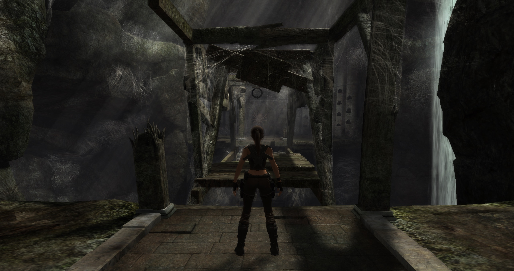
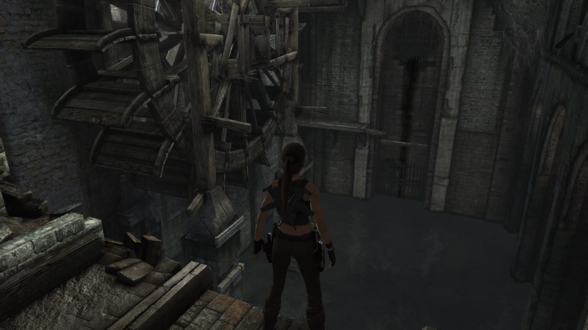
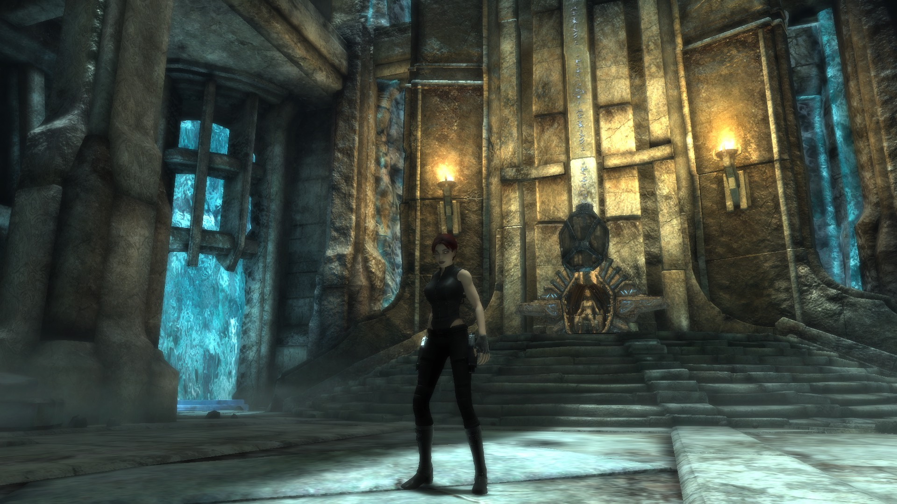

# Tomb Raider: Underworld – DLC for PC

**Play the two Xbox 360-only chapters of *Tomb Raider: Underworld* - *Beneath the Ashes* and *Lara's Shadow* - on
the PC version of the game.**

This is my personal, unofficial fork of [andrearicci93/trudlcport](https://github.com/andrearicci93/trudlcport), the
project that first converted the DLC for the PC. You need your own copy of the game and your own Xbox DLC files.


-8A2BE2)


*Development build (9 Nov 2026): the combat tutorial of Lara's Shadow on PC with TruMenu's debug labels (thrall,
trigger volume, spawn generator), measured against the Xbox 360 original in an emulator ([DEVLOG](docs/DEVLOG.md)).*

> [!WARNING]
> **This is a personal fork, not the original project.** For installing the DLC port, releases and reporting
> problems, use the original: **[andrearicci93/trudlcport](https://github.com/andrearicci93/trudlcport)**.

> [!NOTE]
> **Built with AI assistance.** The changes on branch `windows` (scripts, tools, documentation) were written with
> [Claude Code](https://claude.com/claude-code) (Anthropic's AI assistant), directed and checked by me, and tested on
> one Windows PC with my own copy of the game and my own Xbox 360 DLC files. They may contain mistakes.

The original's full history is kept; my work sits on branch `windows` ([`main...windows`](../../compare/main...windows)).
It does not replace the original. More about the fork: [docs/README.md](docs/README.md#about-this-fork).

**What this fork does**

1. **The DLC port for PC.** DLC 1 *Beneath the Ashes* and DLC 2 *Lara's Shadow*, converted from the Xbox files by the
   upstream pipeline run on Windows. For DLC 2 the fork makes its own conversion; data faults found in game become
   pipeline steps.
2. **The Xbox title update's program code as plugins.** The shadow power of *Lara's Shadow* came with an Xbox game
   update, not with the DLC files. Its functions are translated one by one into ASI plugins (shadow power, combat,
   HUD, rock veins, the doppelganger as player).
3. **Fixes and comfort for the base PC game.** `TruQoL` (60 fps cap, field of view, camera shake; **fixed: the
   start-up crash on PCs with more than 31 CPU threads** - `[Startup] ThreadCap=8`, no Steam launch option such as
   `/affinity FFFF` needed any more), the title update's three base-game fixes the PC never got (in `TruRockVein`: ledge
   corners, jump targets on poles and pillars, ledge detection), the test menu `TruMenu`, `Set-TruDisplay.ps1` and a
   table of known problems.

## Install the DLC

The port itself is the original project's release kit. **This fork has no releases**: no kit, no built plugins.

**You need:** *Tomb Raider: Underworld* from Steam (PC, `tru.exe` v1.1) and your own Xbox 360 DLC folders. Optional,
for the end-credits movies: [RAD Video Tools](https://www.radgametools.com/bnkdown.htm) (free) - without it each DLC
ends on a black screen after its last cutscene. Python 3.9+ must be installed ([python.org](https://www.python.org/)).

**Steps**

1. Download this repository as a zip (*Code* -> *Download ZIP*) and unzip it into a new empty folder (called `TRU-DLC`
   here), so that you have `TRU-DLC\<repository folder>\Install.bat`. Downloads, venv and logs go into `TRU-DLC\`.
2. Copy your Xbox DLC folders `9CA70CF0EDA43654D158C2E37470D301DFA850E753` (*Beneath the Ashes*) and
   `600A12643FCDAC84003E6E0DBD0A1A8F7DAE9DD153` (*Lara's Shadow*) from the console's
   `Content\<profile>\534307EC\00000002\` into `TRU-DLC\input\xbox-dlc\` (raw package files: `TRU-DLC\input\xbox-dlc-live\`).
   The script names the exact folder if they are missing.
3. Close the game and double-click `Install.bat`. `Install.bat -Check` in a command prompt only lists what it would
   do.

`Install.bat` fetches what is missing (pinned versions, SHA-256 checked, skipped when already there): ModLoader v1.2,
the original's B270 kit with `install_dlc.py` / `tex_convert.py` / `credits_convert.py`, `bsdiff4` + `numpy` in its own
Python venv, ffmpeg for the credits. Then it runs the original's installer (dry run first), builds and installs the
DLC 2 plugins when Visual Studio is there, and turns on fullscreen effects and depth of field. It also fetches
Steamless and unpacks `tru.exe` with it (checked by MD5). Afterwards: lock the game to 60 fps, start a **new**
game from *Downloadable Content*. The manual way, update, uninstall, error messages: [docs/INSTALL.md](docs/INSTALL.md).

The conversion itself still comes from the original's kit. The fork's own pipeline
([docs/WINDOWS_REBUILD.md](docs/WINDOWS_REBUILD.md)) now assembles a complete tree in which no file is derived from a kit
file (offline, 11 Nov 2026; not played yet). Every kit file has its own counterpart now (both credits movies, the
doppelganger costume) or is replaced on purpose by the PC original. The gap is the shaders: the pipeline step `Shaders`
makes 829 of the 1 221 shader sections of the played fixes word-equal, and 26 DLC 1 materials still use substitute
shaders - a port fully without the kit is not possible yet.

**This fork's plugins.** The title-update plugins (point 2 above) live in [`src/asi/`](src/asi/). `Install.bat`
builds them with Visual Studio (x86) if it finds it (`-NoPlugins` skips them, `-NoMenu` leaves TruMenu out, `-QoL`
adds TruQoL). By hand, game closed ([scripts/windows/README.md](scripts/windows/README.md)):

```powershell
.\scripts\windows\Build-TruAsi.ps1 -Name TruShadowPower      # -> work\asi\
.\scripts\windows\Set-TruShadowPower.ps1 -Install           # the same for every Set-Tru<Plugin>.ps1
```

- DLC 2 as on the Xbox: `TruShadowPower`, `TruShadowCombat`, `TruRockVein`, `TruDoppelganger`, `TruDlc2Player`;
  `TruShadowHud` only with a `generalbank.drm` that has the title update's HUD script (`tools/generalbank_hud_build.py`).
- Base game, every level: `TruRockVein` also carries the title update's base-game fixes - `[LedgeCorner]`,
  `[JumpTarget]` (0.12) and `[LedgeProbe]` (0.13), each `Translate=1` by default.
- `TruShadowPower` reads the doppelganger camera tables from your own Xbox title update when it is built
  (`TitleUpdate.000`; `Build-TruAsi.ps1 -TitleUpdate <file>`, default `TRU-DLC\data\TombRaiderUnderworld_Patched\`).
  Without it the plugin is built without these tables and the build log says so. No title-update data is in the
  repository.
- Optional: `TruQoL` (60 fps cap, field of view, start-up fix for PCs with more than 31 CPU threads, main menu at
  normal speed after quitting a level from the pause menu; 0.1.6: save retried while a virus scanner holds the file,
  `[Save] RetryOnLock`, default 0, built, not yet tested in game), `TruMenu`, `TruMercLang`. `TruLink`, `TruTrace`, `TruDataGuard` and `TruGuard` are developer tools.
- Tested only on the author's own build (B138 base with the fork's own DLC 2 conversion), **not on the B270 kit**.
  Every plugin checks the bytes of `tru.exe` first; where they differ, that part stays off and its log says why.

Per plugin: [docs/PLUGINS.md](docs/PLUGINS.md).

## Optional: TruMenu (quick bar only)

From 0.22.18 the shipped `TruMenu.ini` opens only the quick bar at the left screen edge: `[Quick] Enabled=1`, the big
menu window and the radial ring off (`[Menu] Enabled=0`, `[Radial] Enabled=0`).

1. Build: `.\scripts\windows\Build-TruAsi.ps1 -Name TruMenu` (compiles Dear ImGui too).
2. Install, game closed: `.\scripts\windows\Set-TruMenu.ps1 -Install -SourceDir .\work\asi`. Needed: `TruMenu.asi` +
   `TruMenu.ini` next to `tru.exe`, loaded by the ASI loader of the ModLoader `binkw32.dll` proxy. Optional:
   `TruMenu.switches.txt` (page "Fixes"), `.radial.txt` / `.tour.txt` (ring), `.media.txt` (track names),
   `.shaderlabel.txt` (shader labels); a missing file only leaves its page empty.
3. In game, Xbox controller: **View + Start** opens / closes the bar; D-pad up / down = row, left / right = off / on,
   LB / RB = page, X = run the row. The game keeps running. German menu: `[Quick] Language=de`.

From 0.22.19 the bar opens on the page it showed last; newer rows turn the main-menu attract video off, show the
teaser timer and give infinite shadow power for testing; `TruMenu.switches.txt` takes up to 512 switch rows (0.22.23).
0.22.24 logs falls out of the world and can put Lara back on safe ground (`[Rescue] FallNet`, default 0); 0.22.26 adds
a test arena on the page Tests (`arena.go 1a|1b|1c`: three flat floors with enemies, the adrenaline meter rows);
0.22.27 adds a read-only save / checkpoint probe (`save.pending`, `save.inv`, `save.waiting`, `save.find <id>`,
`[Log] Save`) - installed 11 Nov, not yet played.

Before 0.22.18, `[Menu] Enabled=0` turns all of TruMenu off. Controls and pages:
[src/asi/TruMenu/README.md](src/asi/TruMenu/README.md).


*Development build (7 Nov 2026): the quick bar at the start of Lara's Shadow, page "Kostueme" (TruMenu 0.21.6).*

## Progress (state 2026-11-15)

Percentages are **estimates**: the share of the Xbox behaviour seen working in game on one PC, judged from the test
findings and the open lists. The title-update rows are counts; the kit and player-path rows are offline states, not
played. "Installed, not played" = built and in the game folder, not yet checked in game; "built, not yet tested in
game" = in the source, not in the game folder. Left out on purpose and not counted as missing: the Xbox Live advert
"new download available" in the pause menu (title-update script 7, 12 textures).

| Part | Estimate | What works | What is missing |
|---|---|---|---|
| DLC 1 *Beneath the Ashes* | `█████████░` ~90 % | played; "display driver" box, cinematic speech in five languages fixed; dungeon loads and reloads after death without the crash; grapple ring right (guarded pipeline rule); starts after DLC 2 in the same session | no replay on the current build yet; 77 of the kit's 108 shader materials translated by the fork, menu text ids mapped right by the pipeline, symbol paths resolved by name - full pipeline run of 12 Nov, built, not yet tested in game; from 14 Nov: the real level order (water tunnel, dungeon, then pillory) read from the play logs; the pillory reload hang was our converter data (cell stream lists) and its crash PC game code - converter fix and a `TruQoL` 0.1.8 switch built, not yet tested in game; dungeon water material translated and the sonar map meshes fixed in the converter (offline); the DLC 1 start with the ported PDA file crashed in game (cause fixed offline, latest build not yet played); the doppelganger costume fired the grapple on the left stick (played; fix built offline) |
| DLC 2: levels / story | `████████░░` ~80 % | played through the Yggdrasil halls to the end level and its cutscenes; doppelganger look, wall run, waterfall; the hall02 combat tutorial goes on after a kick, as on the Xbox | rock-vein jump from a ledge turns back; some materials still drawn with substitute shaders; twice no third tutorial thrall came (cause narrowed); DLC 2 from the pause menu without the outfit screen, as the title update (`TruDlc2Player` 0.6), installed, not played |
| DLC 2: combat and lock-on | `████████░░` ~80 % | as on the Xbox for single hits, the punch combo (20 / 40 / 60 / 80), the big-hit fall and the kick kill (`TruShadowCombat` 0.6.8-0.6.10); melee kill and chunkdoll; shooting with the shadow power; LT locks on and the ring shows (pipeline step `playerblock`); the finisher Y starts | finisher Y: Lara leaps past the target and the thrall gets up again - the title update's steering and kill installed, not played; the ring with the shadow power not seen yet; Lara's aim records 715 / 722 against 718 on the Xbox (to check); adrenaline read from the code - mode on R3, the vault-off strike needs a full meter + LT lock + X, headshot circle and damage path; log, assist and fill / drain options (`TruShadowCombat` 0.6.14, all defaults = game) installed 12 Nov, not played |
| DLC 2: shadow power and camera | `████████░░` ~75 % | slow motion, meter and HUD, power states, wall run; climbing camera with the doppelganger's own camera settings (`TruShadowPower` 0.25): better in game, "sometimes lags behind" | at the goo drip the PC stays in slow motion while Lara runs (Xbox: normal speed); `TruShadowPower` 0.26 (climb-mode tables, camera trace) with a generalbank that has the real camera settings, and 0.27 (the title update's time step for camera shakes and five places of Lara's code; 0.27.1 installed 12 Nov with these switches off) - not yet played; ponytail in slow motion: the title update's cloth time step installed, not checked; shadow bar full right after the switch to DLC 2 (`TruShadowPower` 0.27.2) built, not yet tested in game |
| DLC 2: cutscenes / end + credits | `██████░░░░` ~60 % | end cutscenes visible, throne flicker worked around; cutscene pause and subtitle language live (TruMenu); DLC 2 credits movie built locally | the end chain (finale, credits, menu) not yet played through; the throne's warm top light missing with the workaround |
| DLC 2: hints, banners, PDA | `███████░░░` ~70 % | loading-screen titles and hint boxes; the "OBJECTIVE REVEALED" banner shows; full sonar map over all floors with a colour per area and the far fade as a value (TruMenu 0.22.49-0.22.52, played 14 Nov in DLC 1 and the base game) | the banner names the button (BACK) instead of its icon, as the PC base game does (optional text rule built, not installed); the ported DLC 2 journal PDA (no sonar there by design - the prototypes have none either) crashed in game on 14 Nov in three ways (one-element UI paths, list counts in Xbox byte order, a model pointer) - all three fixed offline with new gates, the latest build not yet played; without it the PC shows the base PDA in both DLCs; UI text ids fixed in the pipeline; the D-pad gave the diving tanks instead of the PDA (an object id left as the Xbox id, new pipeline step `objfield`) - both in the full run of 12 Nov, not yet installed; button icons by the last used device (TruMenu option, off by default) installed, not played |
| DLC 2: sounds | `███████░░░` ~70 % | 118 silent and 46 wrong wave references of the doppelganger's body sounds and 56 in 20 other DLC 2 files fixed (pipeline step `waveid`), installed; sound groups 77 / 78 decoded (echo / chorus); the tone left with every sound muted is the game's own reverb send (found and silenced with TruMenu, played 14 Nov) | not heard in game yet; a moaning sound loops; echo / chorus effect not decided (listening pairs ready); 13 wave ids inside animation event lists fixed in the full run of 12 Nov (goo cannon, goo converter, viking / yeti thralls), not installed; one wave id that DLC 2 reuses is masked by the PC's always-loaded generalbank (decision open) |
| Menus | `████████░░` ~80 % | ring menu: DOWNLOADABLE CONTENT on slot 7 in the main **and** the pause menu, QUIT GAME on ring position 14 (no crash); main-menu attract video off (TruMenu) | last ring layout (door fades in like the slots) installed, not played; main menu at half speed after quitting from the pause menu - `TruQoL` 0.1.4 fix installed, not played |
| Base game: level chain | prologue + area 1 of 7 played | the whole chain from the data - 101 visits over 81 units, 7 level changes, checkpoints in walking order (TruMenu chapter page, 0.22.35); played and logged on 12 Nov from the prologue to the Thailand load: unit order, both level changes, return path and checkpoint order confirmed | correction from that run (one checkpoint belongs to the return path) not yet in the table; areas 2-7 not played with the log; some base loading screens stay black - narrowed on 14 Nov (data and start path ruled out, black exactly when the screen is held until the intro), not fixed |
| Base game: title-update fixes | 1 of 3 in game | the title update (March 2009) fixed three base-game faults the PC never got - all exe code, it changed no base-game data; ledge corners (`TruRockVein` 0.11) installed and active (corrections in the play log) | jump targets on poles and pillars (0.12) and ledge detection (0.13) - installed 11 Nov, not yet played |
| Kit independence | offline | the fork's own tree: 573 files, none derived from a kit file (generalbank from the player's PC patch, 60 language variants, exe, sound info, both credits movies, the doppelganger costume - step `DoppelCostume`); step `Shaders` + translator `shader_translate.py`: 829 of 1 221 shader sections word-equal with the played tree | 26 DLC 1 materials the translator still refuses; where a kit is still right (13 Nov, against the full run of 12 Nov: B270 201 data words + 6 sections, B138 44 words, down from 478 + 5 / 68) - causes known (curve keys with 20-99 base samples, one count word converted like an id, a second model copy, small single cases), rule fixes open; where the fork is right: B270 570 words + 1 784 silent kit waves, B138 10 289 words; full pipeline run of 12 Nov (all steps exit 0; against the played tree 53 sections differ, none needed); the own tree not played |
| Player path | offline | build without the Xbox base game: steps P0 (file manifest, access guard, gate) and P1 done - Generalbank, Globalsound and Lang need only the PC game, the player's title update and DLC packs | the other pipeline steps not moved yet (P2 onwards); the shader steps still read developer data |
| Title-update translation | `█░░░░░░░░░` 16 % | of 1 168 changed / moved / new functions: 108 ported, 66 partial, 6 explained, 72 irrelevant (`tools/tu_coverage.py`, 12 Nov; 16 % = ported + explained + irrelevant; since 12 Nov the tool also pairs functions the TU linker only moved and sees the ~1 900 leaf functions without unwind data) | 916 open; "open" also counts functions not judged yet. Probably many are never needed on PC (Xbox-only code: Live, storage, achievements, platform layer); the count is a work list, not the share of the DLC that is missing |
| Costume packs | `█████░░░░░` ~50 % | converted and checked offline (pipeline step `Costumes`); the DLC 2 "Dopple Costume 1" from the fork's own pipeline | not played yet; 940 of 3 102 wave leaves in the six packs point nowhere (`waveid` skips renumbered base sound sections there) and one string table is byte-swapped - fix list ready, decision open |

**Where to read on**

- [docs/README.md](docs/README.md) – index of all documents, by reader
- [docs/PLUGINS.md](docs/PLUGINS.md) – every plugin: purpose, version, state, INI switches; how the title update is
  brought to PC
- [docs/INSTALL.md](docs/INSTALL.md) and [docs/TROUBLESHOOTING.md](docs/TROUBLESHOOTING.md) – install, known problems
- [CHANGELOG.md](CHANGELOG.md) – section "Fork branch `windows`": every change by date
- [docs/ENGINE.md](docs/ENGINE.md) – how the engine works, with addresses and proofs; section 23 lists leftovers of
  cut features (photo mode, Legend kick props, the script / native census of `tools/unused_scan.py`)
- [docs/DLC2.md](docs/DLC2.md) – DLC 2 notes and the shadow power analysis

Versions of this fork are named `<date>[.<n>]-B<upstream build>`, e.g. `20261027-B138`: the B number is always the
original's build it is based on.

All credit for the port itself goes to **andrearicci93**. License: MIT, as the original ([LICENSE](LICENSE)).

---

*The original README follows unchanged, as of B270 (upstream `main` 7761890); releases and the installer are in the
[original repository](https://github.com/andrearicci93/trudlcport).*

# trudlcport

This project ports the **Xbox 360-only DLC of Tomb Raider: Underworld** to the **Steam PC game**, with no emulator:

- **Beneath the Ashes** (DLC1) can be played from the start to the end credits.
- **Lara's Shadow** (DLC2) can be played as the doppelganger through its levels. Its ending is fixed offline but has not yet been confirmed in game.

Latest build: **B270** (release build `B270_acqua`) → [Releases](https://github.com/andrearicci93/trudlcport/releases/latest)

B270_acqua is B269_nativo (B269_tubi plus native-D3D9 shader fixes) plus a fix for black water in the DLC1 dungeons. B269_tubi was tested in the VM; B269_nativo is in its first VM test; B270_acqua was installed in the VM: the black water of the DLC1 dungeons is fixed (it now looks translucent, like on Xbox).


## Screenshots

On the Steam PC game, no emulator:

| Beneath the Ashes (DLC1) | Beneath the Ashes (DLC1) | Lara's Shadow (DLC2) |
|---|---|---|
|  |  |  |
| The cobwebbed bridge, build B269_nativo | The water wheel hall, build B269_nativo | The doppelganger in the ceremony room, build B269 |

## What you need

- **Tomb Raider: Underworld**, the Steam PC version (exe v1.1).
- **Your own Xbox 360 DLC files**: `pack10.000` (Beneath the Ashes) and `pack11.000` (Lara's Shadow). For the end credits you also need `credits_DLC1.wmv` and `credits_DLC2.wmv`.
- [Steamless](https://github.com/atom0s/Steamless/releases), run once on your own `tru.exe`. The patched exe is built from its output.
- [ModLoader](https://github.com/TombRaiderModding/ModLoader/releases) in the game folder.
- **Python 3.9+**, then `python -m pip install bsdiff4 numpy`.
- For the end credits only, on Windows: [ffmpeg](https://www.gyan.dev/ffmpeg/builds/) and [RAD Video Tools](https://www.radgametools.com/bnkdown.htm). **Without the credits movie, the game stays on a black screen after the final cutscene of each DLC.**

## Install

> **Temporary test kit.** The B270 kit attached to the release is a test build for a few testers. It still carries about 37% of the installed bytes literally inside the patches (see Legal). The final release will not: the installer will recreate every file from your own game data.

1. From [Releases](https://github.com/andrearicci93/trudlcport/releases/latest) download `install_dlc.py`, `tex_convert.py`, `credits_convert.py` and `trudlcport-kit-B270.zip`. Put them in one folder and unzip the kit there into a folder named `kit`.
2. Run Steamless on `<game folder>\tru.exe`. It writes `tru.exe.unpacked.exe` next to it; leave that file there.
3. Close the game and check your files first. This step writes nothing:
   `python install_dlc.py --game "<game folder>" --dlc "<folder with the Xbox files>" --kit kit --check`
4. If it says **All inputs OK**, run the same command without `--check`. Add the credits options if you want them:
   `--credits --rad "<...\radvideo64.exe>" --ffmpeg "<...\ffmpeg.exe>"`
   This takes 5-20 minutes per DLC.
5. Lock the game to **60 fps**. In Steam, go to *Downloadable content* and start a **new** DLC game.

What the installer does:

- **Checks everything.** It verifies every source file and every installed file against MD5s.
- **Uses all your CPU cores.** Files are rebuilt in parallel (up to 8 processes; about 1.5 minutes for the 484 files on a 10-core PC instead of ~8). If the PC runs out of RAM, lower it with `--jobs 2` (`--jobs 1` = sequential).
- **Keeps backups.** Your previous `mods\` folder and `tru.exe` are kept.
- **Writes an install record.** `trudlcport_install.json` lists what was installed:
  - `python install_dlc.py --game "<game folder>" --verify` re-checks the installed files.
  - `python install_dlc.py --game "<game folder>" --restore` undoes the install. It deletes nothing: removed files are renamed with a date suffix.

Full guide: [docs/INSTALL.md](docs/INSTALL.md).

## Requirements and settings

- **Lock the game to 60 fps.** Physics and camera are tied to the frame rate. Above 60 fps, boxes, ragdolls and physics puzzles break. Any of these works:
  - in-game V-Sync on a 60 Hz display, or `EnableVSync=1` in the registry;
  - the NVIDIA *Max Frame Rate* or AMD *Frame Rate Target Control* limiter;
  - RTSS;
  - [dxwrapper](https://github.com/elishacloud/dxwrapper) with `LimitPerFrameFPS = 60`.
- **Windows' own Direct3D 9** should accept every shader of B270. Builds B147-B268 contained up to 240 pixel shaders (counted on B269_tubi) with forms that a real AMD driver rejected, which showed up as *"A problem has occurred with your display driver"*. Since B269 the expected count is 0. This is checked offline only; the native test still has to confirm it on a real GPU.
- **[DXVK](https://github.com/doitsujin/dxvk/releases)** is the fallback if a GPU still refuses something: copy `x32\d3d9.dll` next to `tru.exe`. dgVoodoo2 also works.

## Troubleshooting

| Symptom | What to do |
|---|---|
| `tru.exe: need the Steamless-unpacked v1.1 exe` | run Steamless on the Steam `tru.exe` (MD5 `b36da327…`) and try again |
| `source ... has a different MD5` | your game or DLC file is a different version or is damaged. Use "Verify integrity" in Steam |
| Black screen after a final cutscene | `movies\credits_DLC1.bik` / `credits_DLC2.bik` is missing: run the installer again with `--credits` |
| Crash right at start-up, now and then | the FMOD audio init fails and the game ignores the error. Start the game again |
| "A problem has occurred with your display driver" | run the native test (`trudlcport-native-test-v3.zip` in the release) and send `trudlcport_native_result.zip`. Meanwhile use DXVK |
| Boxes, ragdolls or camera behave strangely | lock the game to 60 fps |
| The DLC is missing from the menu | ModLoader is not installed |

More: [docs/TROUBLESHOOTING.md](docs/TROUBLESHOOTING.md).

## Status (B270)

"Played" means the project owner ran it in game (Windows 11 VM, dgVoodoo2). "Offline" means it was only checked with static gates and comparisons against the Xbox/PC originals.

| | |
|---|---|
| DLC1 *Beneath the Ashes* | Played end to end on B132. Later builds carry back to DLC1 the data fixes found for DLC2, all verified offline. The VM tests of B139-B269 focused on DLC2, so a full replay of DLC1 on B270 is still to do. |
| DLC2 *Lara's Shadow* | Played on B231-B269, up to the final area: <br>• the doppelganger's costume, colours, hair and attacks (Q/E, Shift+E, finisher) <br>• thralls, goo cannons, pools, bridges, columns <br>• the ceremony-room cutscene <br>• flying with F2 without crashes |

Known open issues:

- **Cutscene flicker on Natla.** Block-shaped patches appear on Natla, the doppelganger and the throne in the Natla cutscene. Cause not found.
- **Wall-run on the rock veins.** It does not grab in some places: on B269 one vein in front of the doppelganger reported `NONE`. It still has to be checked spot by spot.
- **Goo FX in the ceremony room switched off.** The four `dlc_fx_goo_ceremony*` effects rendered wrong shapes, so their emitters are at 0. The goo itself is fine.
- **Black water in the DLC1 dungeons (material 20262).** Fixed offline in B270, not yet seen in game. The surrogate vertex shader 976 did not write COLOR0, which the water pixel shader uses for its alpha. A newer driver reads that as 0, so the water turned invisible over a dark floor. The water now uses the base-game VS 164, the same shader plus vertex colour. Material 26584 in the DLC2 treasure room is fixed the same way (VS 243).
- **Guillotine (`dlc1_uo_guillotine`).** Not fixed. Its pixel shaders 738/739 discard on `v0.w`, which vertex shader 211 never writes.
- **Machine room.** The terrain (material 26622) is black: the fix is ready but needs a vertex shader too. The dark pipes (materials 22915/25901) are fixed offline in B269 and not yet confirmed.
- **Goo grinder / goo converter material 25165.** Black surrogate shader, not fixed.
- **Final sequence of DLC2.** The 045 → 050 → credits chain is fixed offline in B266, not yet confirmed. Credits need `credits_DLC2.bik`.
- **Older open items.** Rare FMOD crash at start-up, golden shotgun untested, dungeon material 23211.

Per-area detail: [docs/STATUS.md](docs/STATUS.md). Changes since B138: [CHANGELOG.md](CHANGELOG.md).

## Credits

- The Tomb Raider modding community, for [ModLoader](https://github.com/TombRaiderModding/ModLoader) and the TR8/cdcEngine format work.
- Xenia, for the Xenos texture and shader documentation.
- [Steamless](https://github.com/atom0s/Steamless), [DXVK](https://github.com/doitsujin/dxvk), [dgVoodoo2](http://dege.fw.hu/), [ffmpeg](https://ffmpeg.org/) and RAD Video Tools, which are used but not redistributed.
- The players who tested on real GPUs and sent native-test reports.

## Legal

Tomb Raider: Underworld and its DLC belong to their respective owners. This is an unofficial fan project for people who own both the PC game and the Xbox 360 DLC.

- **No game data in the repository.** It contains only code, documentation and tables of checksums.
- **The release kit is a set of binary patches** that the installer applies to your own files, after checking their MD5s.
  - Xbox textures are converted on your PC by `tex_convert.py`, not shipped.
  - The exe patch is computed against the Steamless output of your own `tru.exe`, so the kit does not carry the game's code.
  - What the installer cannot yet recreate on your PC is still **literal inside the patches**. Measured on the B269/B270 builds with `tools/release/patch_audit.py`, as a share of the installed bytes (decompressed):
    - about 37% overall;
    - about 29% of the DRM bytes: animation, mesh, audio and shader sections;
    - about 99% of the re-encoded `.mul` audio;
    - about 42% of the menu images;
    - 0.2% of the exe, which is code written for the port.
    Previous kits (B132/B138) were about 97% literal and included the credits movie.
- **The credits movies (`.bik`) are never distributed.** You make them on your PC from your own `.wmv` files with `credits_convert.py`.
- Code is MIT-licensed (see `LICENSE`).
