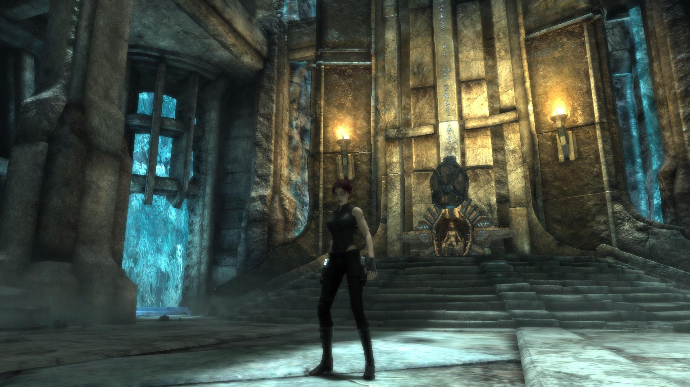

# trudlcport

This project ports the **Xbox 360-only DLC of Tomb Raider: Underworld** to the **Steam PC game**, with no emulator:

- **Beneath the Ashes** (DLC1) can be played from the start to the end credits.
- **Lara's Shadow** (DLC2) can be played as the doppelganger through its levels. Its ending is fixed offline but has not yet been confirmed in game.

Latest build: **B269** (release build `B269_nativo`) → [Releases](https://github.com/andrearicci93/trudlcport/releases/latest)

B269_nativo is B269_tubi plus native-D3D9 shader fixes. B269_tubi was tested in the VM; B269_nativo itself has not been played yet.

## What you need

- **Tomb Raider: Underworld**, the Steam PC version (exe v1.1).
- **Your own Xbox 360 DLC files**: `pack10.000` (Beneath the Ashes) and `pack11.000` (Lara's Shadow). For the end credits you also need `credits_DLC1.wmv` and `credits_DLC2.wmv`.
- [Steamless](https://github.com/atom0s/Steamless/releases), run once on your own `tru.exe`. The patched exe is built from its output.
- [ModLoader](https://github.com/TombRaiderModding/ModLoader/releases) in the game folder.
- **Python 3.9+**, then `python -m pip install bsdiff4 numpy`.
- For the end credits only, on Windows: [ffmpeg](https://www.gyan.dev/ffmpeg/builds/) and [RAD Video Tools](https://www.radgametools.com/bnkdown.htm). **Without the credits movie, the game stays on a black screen after the final cutscene of each DLC.**

## Install

1. From [Releases](https://github.com/andrearicci93/trudlcport/releases/latest) download `install_dlc.py`, `tex_convert.py`, `credits_convert.py` and `trudlcport-kit-B269.zip`. Put them in one folder and unzip the kit there into a folder named `kit`.
2. Run Steamless on `<game folder>\tru.exe`. It writes `tru.exe.unpacked.exe` next to it; leave that file there.
3. Close the game and check your files first. This step writes nothing:
   `python install_dlc.py --game "<game folder>" --dlc "<folder with the Xbox files>" --kit kit --check`
4. If it says **All inputs OK**, run the same command without `--check`. Add the credits options if you want them:
   `--credits --rad "<...\radvideo64.exe>" --ffmpeg "<...\ffmpeg.exe>"`
   This takes 5-20 minutes per DLC.
5. Lock the game to **60 fps**. In Steam, go to *Downloadable content* and start a **new** DLC game.

What the installer does:

- **Checks everything.** It verifies every source file and every installed file against MD5s.
- **Keeps backups.** Your previous `mods\` folder and `tru.exe` are kept.
- **Writes an install record.** `trudlcport_install.json` lists what was installed:
  - `python install_dlc.py --game "<game folder>" --verify` re-checks the installed files.
  - `python install_dlc.py --game "<game folder>" --restore` undoes the install. It deletes nothing: removed files are renamed with a date suffix.

Full guide: [docs/INSTALL.md](docs/INSTALL.md).

## Requirements and settings

- **Lock the game to 60 fps.** Physics and camera are tied to the frame rate. Above 60 fps, boxes, ragdolls and physics puzzles break. Any of these works:
  - in-game V-Sync on a 60 Hz display, or `EnableVSync=1` in the registry;
  - the NVIDIA *Max Frame Rate* or AMD *Frame Rate Target Control* limiter;
  - RTSS;
  - [dxwrapper](https://github.com/elishacloud/dxwrapper) with `LimitPerFrameFPS = 60`.
- **Windows' own Direct3D 9** should accept every shader of B269. Builds B147-B268 contained up to 240 pixel shaders (counted on B269_tubi) with forms that a real AMD driver rejected, which showed up as *"A problem has occurred with your display driver"*. In B269 the expected count is 0. This is checked offline only; the native test still has to confirm it on a real GPU.
- **[DXVK](https://github.com/doitsujin/dxvk/releases)** is the fallback if a GPU still refuses something: copy `x32\d3d9.dll` next to `tru.exe`. dgVoodoo2 also works.

## Troubleshooting

| Symptom | What to do |
|---|---|
| `tru.exe: need the Steamless-unpacked v1.1 exe` | run Steamless on the Steam `tru.exe` (MD5 `b36da327…`) and try again |
| `source ... has a different MD5` | your game or DLC file is a different version or is damaged. Use "Verify integrity" in Steam |
| Black screen after a final cutscene | `movies\credits_DLC1.bik` / `credits_DLC2.bik` is missing: run the installer again with `--credits` |
| Crash right at start-up, now and then | the FMOD audio init fails and the game ignores the error. Start the game again |
| "A problem has occurred with your display driver" | run the native test (`trudlcport-native-test-v3.zip` in the release) and send `trudlcport_native_result.zip`. Meanwhile use DXVK |
| Boxes, ragdolls or camera behave strangely | lock the game to 60 fps |
| The DLC is missing from the menu | ModLoader is not installed |

More: [docs/TROUBLESHOOTING.md](docs/TROUBLESHOOTING.md).

## Status (B269)

"Played" means the project owner ran it in game (Windows 11 VM, dgVoodoo2). "Offline" means it was only checked with static gates and comparisons against the Xbox/PC originals.

| | |
|---|---|
| DLC1 *Beneath the Ashes* | Played end to end on B132. Later builds carry back to DLC1 the data fixes found for DLC2, all verified offline. The VM tests of B139-B269 focused on DLC2, so a full replay of DLC1 on B269 is still to do. |
| DLC2 *Lara's Shadow* | Played on B231-B269, up to the final area:  • the doppelganger's costume, colours, hair and attacks (Q/E, Shift+E, finisher)  • thralls, goo cannons, pools, bridges, columns  • the ceremony-room cutscene  • flying with F2 without crashes |

Known open issues:

- **Cutscene flicker on Natla.** Block-shaped patches appear on Natla, the doppelganger and the throne in the Natla cutscene. Cause not found.
- **Wall-run on the rock veins.** It does not grab in some places: on B269 one vein in front of the doppelganger reported `NONE`. It still has to be checked spot by spot.
- **Goo FX in the ceremony room switched off.** The four `dlc_fx_goo_ceremony*` effects rendered wrong shapes, so their emitters are at 0. The goo itself is fine.
- **Machine room.** The terrain (material 26622) is black: the fix is ready but needs a vertex shader too. The dark pipes (materials 22915/25901) are fixed offline in B269 and not yet confirmed.
- **Goo grinder / goo converter material 25165.** Black surrogate shader, not fixed.
- **Final sequence of DLC2.** The 045 → 050 → credits chain is fixed offline in B266, not yet confirmed. Credits need `credits_DLC2.bik`.
- **Older open items.** Rare FMOD crash at start-up, golden shotgun untested, dungeon material 23211.

Per-area detail: [docs/STATUS.md](docs/STATUS.md). Changes since B138: [CHANGELOG.md](CHANGELOG.md).

## Credits

- The Tomb Raider modding community, for [ModLoader](https://github.com/TombRaiderModding/ModLoader) and the TR8/cdcEngine format work.
- Xenia, for the Xenos texture and shader documentation.
- [Steamless](https://github.com/atom0s/Steamless), [DXVK](https://github.com/doitsujin/dxvk), [dgVoodoo2](http://dege.fw.hu/), [ffmpeg](https://ffmpeg.org/) and RAD Video Tools, which are used but not redistributed.
- The players who tested on real GPUs and sent native-test reports.

## Legal

Tomb Raider: Underworld and its DLC belong to their respective owners. This is an unofficial fan project for people who own both the PC game and the Xbox 360 DLC.

- **No game data in the repository.** It contains only code, documentation and tables of checksums.
- **The release kit is a set of binary patches** that the installer applies to your own files, after checking their MD5s.
  - Xbox textures are converted on your PC by `tex_convert.py`, not shipped.
  - The exe patch is computed against the Steamless output of your own `tru.exe`, so the kit does not carry the game's code.
  - What the installer cannot yet recreate on your PC is still **literal inside the patches**. Measured on the B269 dry run with `tools/release/patch_audit.py`, as a share of the installed bytes (decompressed):
    - about 37% overall;
    - about 29% of the DRM bytes: animation, mesh, audio and shader sections;
    - about 99% of the re-encoded `.mul` audio;
    - about 42% of the menu images;
    - 0.2% of the exe, which is code written for the port.
    Previous kits (B132/B138) were about 97% literal and included the credits movie.
- **The credits movies (`.bik`) are never distributed.** You make them on your PC from your own `.wmv` files with `credits_convert.py`.
- Code is MIT-licensed (see `LICENSE`).
